<div align="center">
  

  <h1>BandBox · 小米手环百宝箱</h1>

  <p><b>31 个本地小工具，装进你手腕上那块 212 × 520 的窄长屏。</b></p>
  <p>离线运行 · 零收费 · 零授权 · 无第三方闭源依赖 · MIT 开源</p>

  <p>
    <a href="README_EN.md"><b>English</b></a> ·
    <a href="#真实界面实拍">实拍</a> ·
    <a href="#功能一览">功能</a> ·
    <a href="#安装">安装</a> ·
    <a href="#构建与打包">构建</a> ·
    <a href="https://atomgit.com/gcw_MchqrexB/MiBandBox">AtomGit</a> ·
    <a href="https://github.com/lkjhg10576/MiBandBox">GitHub</a>
  </p>

  <p>包名 <code>com.miband.box</code> · 版本 <code>0.1.0</code>（versionCode 222）· 平台 Vela JS 快应用</p>
</div>

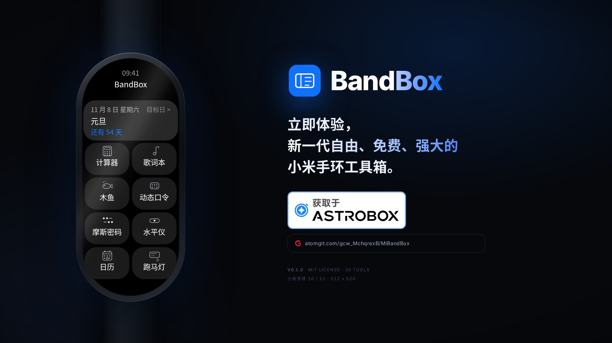

---

## 这是什么

BandBox 是给**小米手环 10 / 11**（212 × 520 跑道屏）做的一个**纯本地**小工具箱。

手环的屏幕窄、可用空间小，通常只能看时间和步数。BandBox 把三十一个小工具塞进这块屏：计算、记录、倒数日、查农历、生成二维码、转摩斯电码、敲木鱼、跑马灯、播放本地歌词、生成动态口令……

全部数据留在手环本地，**不联网、不收费、不注册、不上传**。

| 关键点 | 说明 |
| --- | --- |
| 工具数量 | **31** 个，覆盖实用、记录、趣味与系统信息四类场景 |
| 联网请求 | **0**（没有第三方接口，没有埋点，没有广告） |
| 账号 / 付费 | **0**（无登录、无订阅、无激活） |
| 第三方闭源依赖 | **0**（除可选的官方 AstroBox 插件外无任何依赖） |
| 内置字体 | **0**（直接用 Band 10/11 系统字体 MiSans / MiLan Pro） |
| 许可证 | **MIT** |

> 手机侧只有一个**可选**的 AstroBox 插件「BandBox辅助」，用来把 LRC 歌词推到手表歌词本、同步动态口令账户。不装它，BandBox 的 31 个工具照常工作。

---

## 真实界面实拍

下面每一张都是 **Vela 模拟器（小米手环 10 skin，212 × 520）里跑起来的真实界面**，不是设计稿。

|  |  |  |
| :---: | :---: | :---: |
| 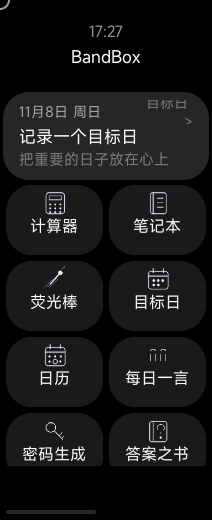 | 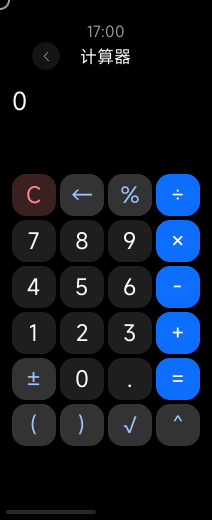 | 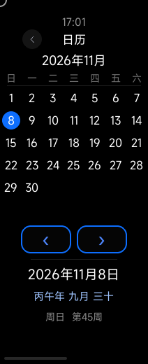 |
| **首页**（双栏网格） | **计算器** | **日历**（农历 / ISO 周数） |
| 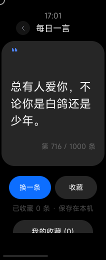 | 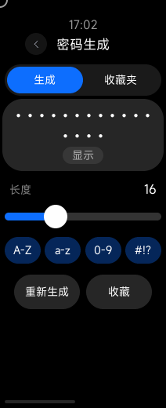 | 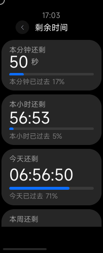 |
| **每日一言**（1000 条） | **密码生成** | **剩余时间**（本分 / 本时 / 今天） |
| 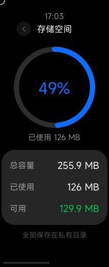 | 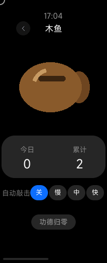 | 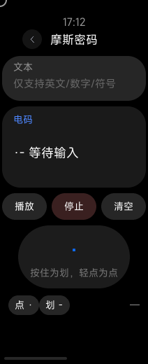 |
| **存储空间** | **木鱼**（今日 / 累计功德） | **摩斯密码**（自动播放 / 手动点划） |
| 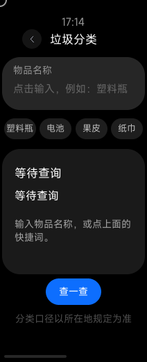 | 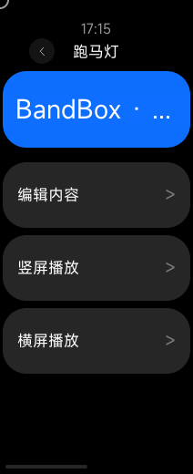 | 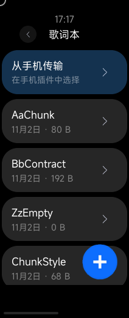 |
| **垃圾分类**（200+ 词表） | **跑马灯**（横竖屏滚动） | **歌词本**（本地歌词 / 手机推送） |
| 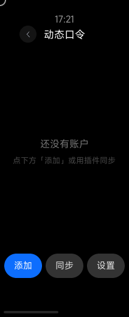 | 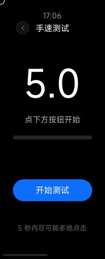 | 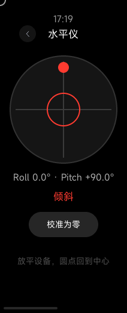 |
| **动态口令**（TOTP 本地生成） | **手速测试**（5 秒 CPS） | **水平仪**（双轴倾角） |
| 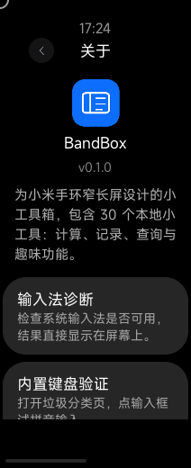 | 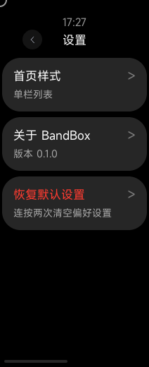 | 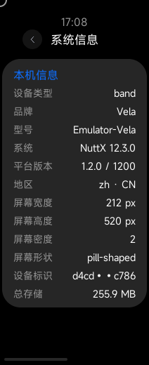 |
| **关于页**（应用图标 / 版本） | **设置页**（首页样式切换） | **系统信息**（型号 / 屏幕 / 存储） |

首页支持**双栏网格 / 单栏列表**两种样式切换（入口：应用列表最后的「设置」→「首页样式」），顶部常驻显示最近的目标日倒计时。

---

## 功能一览

### 🧰 实用工具

| 工具 | 说明 |
| --- | --- |
| 计算器 | 四则运算、括号、百分号、开方、幂 |
| 单位换算 | 12 类物理量、98 个单位，纯本地实时换算（长度 / 质量 / 温度…） |
| 日历 | 月视图，点选日期看农历、周几与 ISO 周数，左右切月 |
| 每日一言 | 1000 条积极短句（原创 + 开源语料筛选），可收藏，随机不重样 |
| 每日新知 | 每天固定一条科技小知识，跨天自动更换，「换一条」随手读 |
| 史载今日 | 全年 366 天史实条目，可上下滚动看全；当天没有史实时才显示一条小知识兜底 |
| 剩余时间 | 本分钟 / 本小时 / 今天 / 本周 / 今年倒计时 + 进度条 |
| 密码生成 | 长度 8–32，字符集可勾选，收藏夹 |
| 摩斯密码 | 文本转电码、自动播放、手动点划 |
| 快捷生码 | 文本 / 网址 / WiFi 二维码 |
| 垃圾分类 | 200+ 物品词表，五分类 |

### 📝 记录与互联

| 工具 | 说明 |
| --- | --- |
| 笔记本 | 新建 / 编辑 / 重命名 / 二维码分享 / 删除 |
| 目标日 | 倒数 / 纪念日，两步式日期选择，本地保存 |
| 记分牌 | 红蓝计分 + 计时器 |
| 动态口令 | TOTP 本地生成 + 倒计时环，手机插件批量导入 / 编辑 / 删除并同步（详见下文） |

### 🎲 趣味玩法

| 工具 | 说明 |
| --- | --- |
| 荧光棒 | 整屏单色循环，可暂停，最亮常亮 |
| 红光手电 | 红光 / 暖橙 / 白光 / 冷光，亮度拉满，进入即亮屏 |
| 跑马灯 | 文字、字号、速度、颜色；竖屏横向滚动，横屏把内容旋转 90° 后滚动 |
| 歌词本 | 本地歌词、自动滚动、横竖屏，支持「从手机传输」接收手机推送的歌词 |
| 水平仪 | 双轴倾角小圆点 + 十字准星，可校准归零 |
| 答案之书 | 随机答案，淡入展示 |
| 木鱼 | 自绘木鱼，今日 / 累计功德，自动敲击，本地保存 |
| 振动器 | 短振 / 长振 / 节奏，间隔可调 |
| 显示测试 | 12 种纯色，检查坏点与色偏 |
| 手速测试 | 独立「开始」按钮，5 秒倒计时 + CPS，结算后点屏幕不会误触重开 |
| 今日饮食 | 吃什么 / 喝什么随机 |
| 随机数 | 区间调整 + 滚动抽取 |
| 数字滚动 | 自动递增计数器，间隔可调 |

### 🖥 系统信息

| 工具 | 说明 |
| --- | --- |
| 系统信息 | 型号、系统、屏幕、设备标识、存储 |
| 性能测试 | 对象 / 数组 / 数学 / 排序四项参考分 |
| 存储空间 | 已用 / 可用 / 总量环图 |

---

## 特色功能

### 📱 从手机传输歌词

歌词本首页顶部有一张「从手机传输」卡片，点进去进入接收页：

1. 手机装 AstroBox 插件 **BandBox辅助**（源码在 `plugin/bandbox-helper/`）
2. 手环停在「从手机传输」页面（保持长亮）
3. 手机插件里点「选择 LRC 文件」→ 选一个 `.lrc`
4. 插件自动识别逐行 LRC、常规逐字 LRC、增强逐字 LRC（ESLyric），并自动剥离时间轴与元数据标签、还原成逐行纯文本，点「发送到手环」
5. 手环弹出「已接收：<歌名>」，歌词本里随即出现该条目

连接状态不再依赖 Vela 的 `getReadyState`（AstroBox 不是官方配套 App，该状态不可靠）：
手机插件每 5 秒主动向手环发一次 `hello` 心跳，手环收到即显示「已连接手机」；
手环也会发 `ping` 探活，插件回 `pong`（部分固件下手环→手机方向不可用，因此以手机心跳为准）。
插件在 `onUiRender` / `device-action` 时会注册手环消息接收，所以手环进页面时发出的 `ready`
也能被收到并回复。协议是本仓库自定义的 `bandbox-lyrics`（JSON 字符串，`app`/`v`/`type` 三个公共字段），
手环端实现见 `src/utils/lyricsTransfer.js`，插件端实现见 `plugin/bandbox-helper/src/protocol.js`，
两端各有一套单测。手机端宿主会把 `interconnect-message` 包在
`{addr, pkgName, payloadText, payloadHex}` 信封里，插件会先解包再解析。
传输通道只有 BLE `interconnect` 一条（`system.interconnect`），
没有局域网 HTTP 兜底。长歌词分片按 UTF-8 字节计量（中文 3 字节/字），
单片正文预算 = 12 KB − 256 B 外层预留 − 标题字节；含超长单行的文件会在插件端被拒绝导入。

### 🔐 动态口令（TOTP）

「动态口令」是内置第 30 个工具：手表本地生成 TOTP 验证码（M1 支持 TOTP / SHA1 / 6 位 / 30 秒，
字段模型与 otpauth 协议已为 HOTP、SHA256/512、8 位、自定义周期预留），与手机插件共享同一条
`bandbox-lyrics` BLE 通道（协议 `bandbox-otp`，靠 `app` 字段分流，互不干扰）。

**手表端**：列表页实时验证码 + 剩余秒；详情页大字验证码 + 倒计时环；编辑页手输 Base32
（走内置输入法）；设置页可调时间偏移（±300s）并说明明文存储风险；支持 otpauth URI 二维码导出
（可被标准 Authenticator 扫码）。密钥保存在手环本地 KV，写后立即落盘。

**手机插件**：插件顶部有「动态口令」Tab（与歌词同步同插件、同连接，无双插件注册冲突）：

1. 「拉取数据」从手环读取全部账户
2. 「批量粘贴」粘贴多行 `otpauth://` 文本导入（兼容 `\/`、`&amp;` 转义与 issuer 前缀），或逐条添加/编辑
3. 编辑/删除先写本地三态（baseline / local / deletedIds），点「保存修改」二次确认后按增量下发
4. 增量按单账户条目分片（每片 ≤ 12 KB），手环逐片确认；回执丢失时本地修改保留可重试
5. 检测到手表时间偏差 ≥ 5 秒会提示一键校时（`set_offset`，不改系统时间）

协议消息：`hello / ready / pong / list_accounts / accounts / sync_delta / set_offset /
chunk / ack / err / progress`，两端实现见 `src/utils/otpProtocol.js` 与
`plugin/bandbox-helper/src/otpProtocol.js`（常量与行为一致），算法内核
`otp.js` 双端逐字一致（SHA-256 校验），RFC 4226/6238 向量全量通过。

**安全须知**：密钥以明文存于手环本地文件（Vela 无加密存储 API），请勿把手环当作唯一 2FA
设备；建议在插件「批量导出」中离线备份 otpauth 文本。时间校准只有手动偏移与手机辅助提示，
不做联网校时。与 WhistleO 官方插件/应用互不相通（包名与协议封装不同，仅数据格式兼容）。

---

## 安装

### 方式一：AstroBox（推荐）

在 **AstroBox** 应用里搜索 **BandBox**，直接安装；更新同理。手机侧的「BandBox辅助」插件是**可选**的，
只有需要手机推歌词 / 同步动态口令时才装。

### 方式二：手动安装 `.rpk`

从 `release/` 或 `beta/` 目录取 `.rpk`，覆盖安装：

```bash
adb push BandBox.rpk /data/app/com.miband.box.rpk
adb shell pm install /data/app/com.miband.box.rpk
adb shell am start com.miband.box
```

> 不要用 `rm -rf /data/app/<pkg>` + `unzip` 的方式安装：那样 AMS 里会残留
> 「文件已删、状态还在」的坏应用，之后 `am start` 只出黑屏。用 `pm install` 覆盖即可。

### 方式三：从源码构建

```bash
npm install
npm run gate           # 发行门禁：只读静态检查，失败即阻断
npm run build          # 开发包：dist/*.debug.*.rpk
npm run build:jsc      # 生成 jsc 字节码，更接近发布包
```

`aiot-toolkit` 已写入 `devDependencies`。如果使用 AIoT-IDE 的内置工具链，也可在 IDE 中直接构建。
`build` / `build:jsc` 的 `pre*` 钩子会先跑门禁，规则见 `tools/release-gate.mjs` 文件头。
发布包需要自己的签名证书（`aiot release`），开发/模拟器验证用 `npm run build` 即可。

---

## 构建与打包

本项目有两条构建通道，打包方式完全相同，区别只在版本号策略与产物目录：

| 通道 | 什么时候打 | 版本号 `versionName` | `versionCode` | 产物目录 |
| --- | --- | --- | --- | --- |
| **Beta** | 没有特殊要求时的默认动作 | 不变 | **+1** | `beta/BandBox-<版本>-<versionCode>/` |
| **发行版** | 明确要求「打包一个新发行版」 | **升** | 不变 | `release/BandBox-<版本>/` |

- 两种模式的产物内容一致：`.rpk`（jsc 字节码）+ `BandBox辅助.abp`（插件源码现编）+ `SHA256SUMS.txt` + `说明.md`。
- **不再产出 zip 压缩包**，直接用目录里的 `.rpk` 覆盖安装。
- 打包命令：

  ```bash
  # Beta（默认）
  NODE_OPTIONS="--require $PWD/tools/copyfile-shim.cjs" bash tools/make-release.sh --beta
  # 发行版（版本提要写 notes/<版本>.md，会自动插进说明.md）
  NODE_OPTIONS="--require $PWD/tools/copyfile-shim.cjs" bash tools/make-release.sh --release <版本> --notes notes/<版本>.md
  ```

  本机必须带 `copyfile-shim.cjs` 垫片，否则 `build:jsc` 会被沙箱的 `copy_file_range` 拦成 `EPERM`。
- 版本号四处同步（`src/manifest.json`、`package.json`、关于页、设置页）由脚本自动完成，门禁 R6 复核。
- 发行前必过 `npm run gate`（`tools/release-gate.mjs`）。

完整约定见仓库根目录 `AGENTS.md` 与 `beta/README.md`。

---

## 目录结构

```
src/
├── manifest.json          57 条路由、权限、features
├── app.ux                 全局 KV / 互联初始化
├── common/                自绘图标、公共图
├── components/
│   ├── BackBtn.ux         统一返回按钮
│   └── Ring.ux            弧形进度环（原生 progress arc）
├── data/                  自建数据集（apps/quotes/answers/food/history/waste/morse/colors/perf）
├── utils/                 kv / fs / docs / time / haptic / router / calc / inputResult / textInput / keyboardText / homeLayout
│                          interconnect（手机互传通道）/ lyricsTransfer（歌词传输协议）
│                          otp / otpAccounts / otpProtocol（动态口令内核与协议，双端一致副本）
│                          otpStore（口令存储）/ otpBridge（常驻接收层）
│                          marqueeState（跑马灯配置的跨页同步传递）
└── pages/                 63 个页面（含单位换算三页）（含 input 文本输入页、lyrics/transfer 接收页、otp/ 动态口令五页）

plugin/
└── bandbox-helper/       AstroBox 插件（API Level 4）：手机端选 LRC 并推送 / 动态口令账户同步

assets/                    README 用的宣传图、实拍截图、收款码
```

---

## 性能

工具链把每个页面打成独立 bundle，公共模块原本在每个 bundle 里各有一份副本。
现在公共模块统一挂在全局单例上（`src/global.js` + `src/utils/g.js`），
页面只 import shim；各页的 20s 时钟合并成一个全局时钟（`src/utils/clock.js`）。

| 指标 | 优化前 | 优化后 |
| --- | --- | --- |
| rpk 大小 | 966,411 B | **648,685 B**（−32.9%） |
| bundle 原始总量 | 8,712,032 B | 4,618,834 B（−47%） |
| router / file / kv 模块副本 | 59 / 37 / 23 | **1 / 1 / 1** |
| 20s 时钟定时器 | 49 个 | **1 个**（无订阅时自动停） |
| PNG 资源 | 102 张 / 156,869 B | 52 张 / 68,573 B（RGBA，保留抗锯齿边缘） |

包体大小可自行复现：`npm run build:jsc` 后看 `dist/*.rpk` 的大小；
本表其余指标由内部工具链实测，工具链本身不入库。

---

## 已知限制

- 文本输入使用随包内置的 `Vela_input_method` 组件（MIT），支持中文拼音、英文、数字；短字段在页面内直接输入，长文本（笔记正文、歌词正文）在独立编辑页输入。
- 歌词本完全离线，不提供在线搜索（避免第三方接口依赖）。
- 「从手机传输」需要手机端安装 AstroBox 插件「BandBox辅助」，且手环需停留在接收页；
  没装插件或插件未加载时，手环页会显示「未连接手机」并给出诊断提示。
- 动态口令密钥明文存储（Vela 无加密存储 API），仅适合低敏账户或做备用 2FA；
  时间校准依赖手动偏移 / 手机提示，不联网校时。
- 性能分为相对参考值，受温度、后台任务和模拟器影响。
- 荧光棒与跑马灯用原生 `@keyframes` 驱动（软件渲染的满帧重绘），长亮页面注意发热；
  动画在 `play.ux` / `textShow.ux` 里，真机若帧率不达标可改回 JS 定时器。
- 模拟器里的快应用绘制区域为 212×466（底部 54px 为系统手势栏）；真机照片显示可继续绘制到约 500，但底部是药丸屏收窄区，仅适合居中窄内容。
- 模拟器冷启动约 10 秒，是 Vela 运行时调试器发现超时导致；真机通常更快。
- 模拟器的鼠标/触摸坐标与画面存在约 40 px 偏移，自动化截图时需自行校准；真机触摸正常。
- Vela 模拟器镜像的文本渲染不稳：重装应用后偶发整页中文变豆腐块或错位，
  重启模拟器（清字体缓存）后恢复。这是模拟器侧的问题，手表真机不受影响。
- 当前仅适配手环 212 × 520 跑道屏（Band 10 / 11），不支持手机与平板。

---

## 贡献与致谢

欢迎提 Issue、PR 或直接改代码提交。改动请先跑一遍 `npm run gate`，门禁不过不予合并。

感谢小米 Vela 平台、AstroBox 平台、米坛社区，以及各开源社区提供的文档与示例。没有你们，这个项目将无法诞生。

---

## 赞助

本项目开源免费，若你从任何渠道购买，请立即申请退款，并前往官方渠道下载。若你愿意小小的赞助作者一杯咖啡，作者将感激不尽，并会在赞助者名单中写上你的名字！

| 微信 | 支付宝 |
| :---: | :---: |
|  |  |

---

## 许可

- 本项目源码以 **MIT** 协议开源。
- 字体使用设备系统字体（Band 10/11 的 MiSans / MiLan Pro），不内置字体子集。
- 内置输入法组件来自 [NEORUAA/Vela_input_method](https://github.com/NEORUAA/Vela_input_method)（MIT），许可证见 `src/components/InputMethod/LICENSE`，在此感谢该作者对 Vela 提供输入法的支持。
