<div align="center">
  

  <h1>BandBox · The Xiaomi Band Toolbox</h1>

  <p><b>36 local tools, packed into the 212 × 520 strip screen on your wrist.</b></p>
  <p>Fully offline · No fees · No accounts · No closed-source dependencies · MIT licensed</p>

  <p>
    <a href="README.md"><b>简体中文</b></a> ·
    <a href="#real-screenshots">Screenshots</a> ·
    <a href="#feature-list">Features</a> ·
    <a href="#install">Install</a> ·
    <a href="#build--package">Build</a> ·
    <a href="https://atomgit.com/gcw_MchqrexB/MiBandBox">AtomGit</a> ·
    <a href="https://github.com/lkjhg10576/MiBandBox">GitHub</a>
  </p>

  <p>Package <code>com.miband.bandbox</code> · Version <code>0.1.0</code> (versionCode 234) · Built with Vela JS Quick Apps</p>
</div>

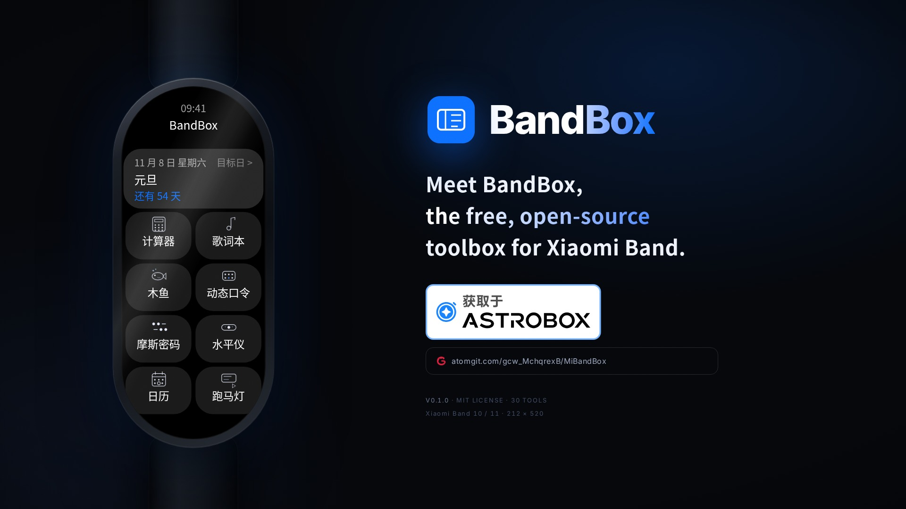

---

## What is this?

BandBox is a **fully local** toolbox built for the **Xiaomi Band 10 / 11** (212 × 520 strip display) and the **Xiaomi Band 9 Pro / 10 Pro** (336 × 480 rectangular display). Each form factor ships as its own package (same app package name, pick the one for your band).

A band screen is narrow and tiny — usually it only shows the time and your steps. BandBox squeezes thirty-six small tools into that space: a calculator, a notebook, countdowns, a lunar calendar, QR codes, Morse code, a wooden fish, a marquee, local lyrics, TOTP codes…

Everything stays on the band. **No network calls, no fees, no sign-up, no uploads.**

| Highlights | Details |
| --- | --- |
| Tools | **36**, covering everyday, notes, fun and system-information use cases |
| Network requests | **0** (no third-party APIs, no telemetry, no ads) |
| Accounts / payments | **0** (no login, no subscription, no activation) |
| Closed-source dependencies | **0** (nothing but the optional official AstroBox plugin) |
| Bundled fonts | **0** (uses the Band 10/11 system fonts, MiSans / MiLan Pro) |
| License | **MIT** |

> The phone side is a single **optional** AstroBox plugin, *BandBox辅助* ("BandBox Helper"), used to push LRC lyrics to the band and to sync TOTP accounts. Without it, all 36 tools work exactly the same.

---

## Real screenshots

Every image below is the **actual running app inside the Vela simulator** (Xiaomi Band 10 skin, 212 × 520) — not a design mock-up.

|  |  |  |
| :---: | :---: | :---: |
| 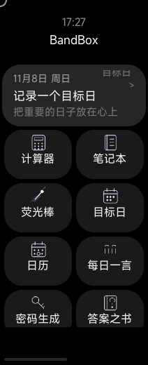 | 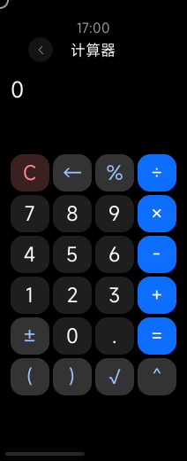 | 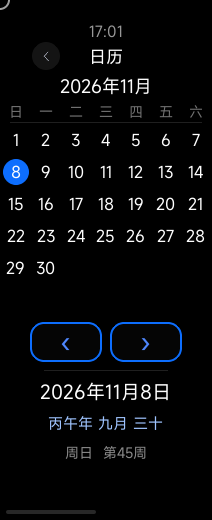 |
| **Home** (two-column grid) | **Calculator** | **Calendar** (lunar date / ISO week) |
| 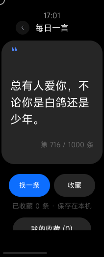 | 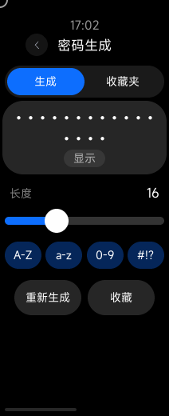 | 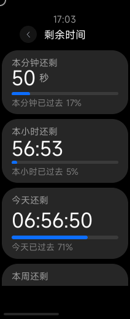 |
| **Daily quote** (1,000 lines) | **Password generator** | **Time left** (minute / hour / day) |
| 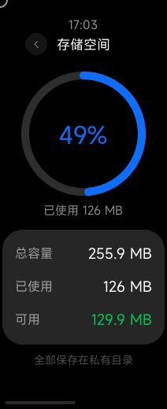 | 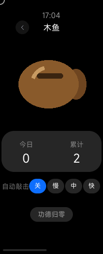 | 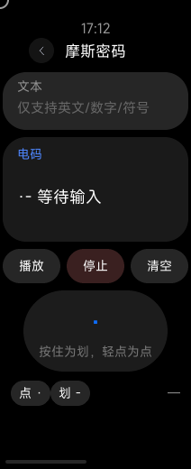 |
| **Storage** | **Wooden fish** (daily / total merit) | **Morse code** (auto playback / manual taps) |
| 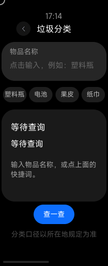 | 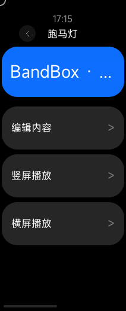 | 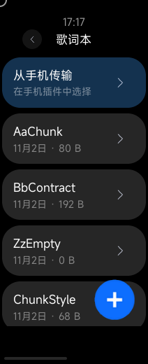 |
| **Waste sorting** (200+ items) | **Marquee** (portrait & landscape) | **Lyrics** (local / pushed from phone) |
| 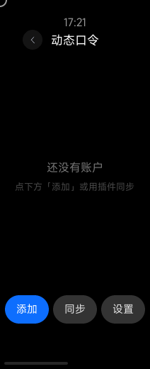 | 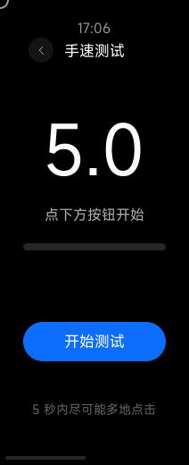 | 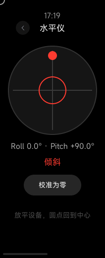 |
| **TOTP** (generated on the band) | **CPS test** (5-second taps) | **Level** (dual-axis tilt) |
| 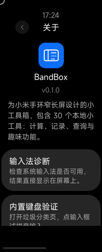 | 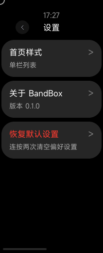 | 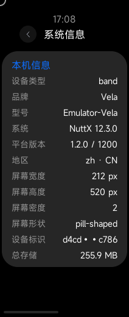 |
| **About** (icon / version) | **Settings** (home layout switch) | **System info** (model / screen / storage) |

The home screen offers a **two-column grid / single-column list** toggle (*Settings → Home layout*) and always shows the countdown of your nearest saved date on top.

---

## Feature list

### 🧰 Everyday tools

| Tool | Description |
| --- | --- |
| Calculator | Four operations, parentheses, percent, square root, powers |
| Unit converter | 12 categories, 98 units, instant fully-local conversion (length / mass / temperature…) |
| Calendar | Month view; tap a date for lunar date, weekday and ISO week number; swipe between months |
| Daily quote | 1,000 uplifting one-liners (original + curated open-source corpus), favourites, no repeats in a row |
| Daily tidbit | One fixed tech fact per day, refreshed automatically at midnight; a "shuffle" button for one-off rerolls |
| On this day | 366 days of historical events, scrollable; only falls back to a tidbit when the day has no record |
| Time left | Countdown for this minute / hour / day / week / year, with a progress bar |
| Password generator | Length 8–32, pick your character sets, favourites |
| Morse code | Text to dots-and-dashes, auto playback, manual tapping |
| Quick QR code | Text / URL / Wi-Fi QR codes |
| Waste sorting | 200+ item lookup, five categories |
| Date calculator | Days between two dates; age from a birthday as years + days and a 4-decimal approximation |
| Counter | Big number in the center, "+" above and "−" below; each tap fires one long vibration and steps ±1, negatives allowed |

### 📝 Notes & connectivity

| Tool | Description |
| --- | --- |
| Notebook | Create / edit / rename / share as QR code / delete |
| Countdown | Countdown and anniversary dates, two-step date picker, stored locally |
| Scoreboard | Red-vs-blue scoreboard with a timer |
| TOTP | On-device TOTP codes with a countdown ring; batch import / edit / delete and sync from the phone plugin (details below) |

### 🎲 Fun stuff

| Tool | Description |
| --- | --- |
| Fluorescent stick | Full-screen single-colour loop, pausable, stays at max brightness |
| Red light | Red / warm orange / white / cool light at full brightness, lights up on entry |
| Marquee | Text, size, speed and colour; scrolls horizontally in portrait, rotates 90° in landscape |
| Lyrics | Local lyrics with auto-scroll in portrait and landscape, plus "transfer from phone" |
| Level | Dual-axis tilt dot with a crosshair, calibratable; four tiers (green / blue / orange / red) follow the tilt |
| Book of answers | A random answer, revealed with a fade |
| Wooden fish | Hand-drawn wooden fish with daily and total counters, auto-strike |
| Vibrator | Short / long / rhythmic patterns, adjustable interval |
| Metronome | Set a BPM; a vibration on every beat, screen stays on while running; vibration strength is selectable (weak = short / strong = long), strong by default |
| Display test | 12 solid colours for dead pixels and colour cast |
| CPS test | A dedicated "start" button, 5-second countdown and taps-per-second, no accidental restart after the result |
| Tap tempo | Untimed: tap the screen along with the beat, live BPM from the last 8 intervals, freezes when you hit "stop"; tap feedback always uses weak strength (short vibration), not adjustable |
| What to eat | Random "eat" and "drink" suggestions |
| Random number | Adjustable range with a rolling draw |
| Light random | Dice (one or two), coin flip or random letter, revealed with a rolling animation |
| Number roll | Auto-incrementing counter, adjustable interval |

### 🖥 System information

| Tool | Description |
| --- | --- |
| System info | Model, OS, screen, device identifier, storage |
| Performance test | Object / array / math / sorting benchmark scores |
| Storage | Used / free / total as a ring chart |

---

## Highlights

### 📱 Transfer lyrics from your phone

The lyrics page has a "transfer from phone" card at the top. Tap it to reach the receiving page:

1. Install the AstroBox plugin **BandBox辅助** on the phone (source lives in `plugin/bandbox-helper/`)
2. Leave the band on the receiving page (screen stays awake)
3. In the plugin, tap "Select LRC file" and pick a `.lrc`
4. The plugin auto-detects line-based LRC, regular per-word LRC and enhanced per-word LRC (ESLyric), strips timeline and metadata tags, restores plain text and sends it to the band when you tap "Send to band"
5. The band shows "Received: <song>" and the entry appears in the lyrics list

The connection state no longer relies on Vela's `getReadyState` (AstroBox is not an official companion app, so that status is unreliable): the phone plugin sends a `hello` heartbeat every 5 seconds and the band shows "Phone connected" as soon as it receives one. The band also sends `ping` probes answered with `pong` (on some firmwares the band→phone direction does not work, hence the phone heartbeat is authoritative). The plugin registers its message listener during `onUiRender` / `device-action`, so the `ready` message sent when the band enters the page is received and answered too.

The protocol is a custom `bandbox-lyrics` JSON string with three common fields (`app` / `v` / `type`). The band side lives in `src/utils/lyricsTransfer.js`, the plugin side in `plugin/bandbox-helper/src/protocol.js`, and each side has its own unit tests. The phone host wraps `interconnect-message` in an `{addr, pkgName, payloadText, payloadHex}` envelope, which the plugin unwraps before parsing. There is exactly one transport — BLE `interconnect` (`system.interconnect`) — with no LAN HTTP fallback. Long lyrics are chunked by UTF-8 byte count (3 bytes per Chinese character); the per-chunk body budget is 12 KB − 256 B envelope reserve − title bytes, and files containing extremely long single lines are rejected at import time.

### 🔐 TOTP codes

"TOTP" is the 30th built-in tool: the band generates TOTP codes on-device (M1 supports TOTP / SHA1 / 6 digits / 30 seconds, and the field model already reserves room for HOTP, SHA256/512, 8 digits and custom periods). It shares the same `bandbox-lyrics` BLE channel with the lyrics transfer (protocol `bandbox-otp`, demultiplexed by the `app` field, no interference).

**On the band**: live code plus remaining seconds in the list, a large code with a countdown ring on the detail page, Base32 entry through the built-in keyboard, and a settings page with a manual time offset (±300 s) and a warning about plaintext storage. otpauth URIs can be exported as QR codes readable by any standard authenticator app. Secrets are stored in the band's local KV and flushed immediately after every write.

**On the phone**: the plugin gains a "TOTP" tab (same plugin and same connection as lyrics sync, so there is no double-registration conflict):

1. "Pull" reads all accounts from the band
2. "Bulk paste" imports multiple `otpauth://` lines at once (handling `\/` and `&amp;` escapes and issuer prefixes), or you add/edit them one by one
3. Edits and deletions are staged locally in three states (baseline / local / deletedIds); tapping "Save changes" asks for confirmation and then pushes only the delta
4. The delta is chunked per account entry (≤ 12 KB each), the band confirms chunk by chunk, and local changes are kept for retry if an acknowledgement is lost
5. If the band clock is off by ≥ 5 seconds, the plugin suggests a one-tap correction (`set_offset`, which does not change the system time)

Protocol messages: `hello / ready / pong / list_accounts / accounts / sync_delta / set_offset / chunk / ack / err / progress`, implemented in `src/utils/otpProtocol.js` and `plugin/bandbox-helper/src/otpProtocol.js` (identical constants and behaviour). The algorithm core `otp.js` is byte-identical on both sides (SHA-256 checked) and passes the full RFC 4226/6238 vector set.

**Security note**: secrets are stored in plaintext in a local file on the band (Vela exposes no encrypted storage API). Do not treat the band as your only 2FA device — keep an offline backup of the otpauth text via "Export all" in the plugin. Time calibration is manual-offset plus phone-assisted hints only; there is no network time sync. It does not interoperate with the official WhistleO plugin/app (different package name and protocol envelope; only the data format is compatible).

---

## Install

### Option 1: AstroBox (recommended)

Search for **BandBox** in the **AstroBox** app and install it there; updates work the same way. The phone-side "BandBox Helper" plugin is **optional** — install it only if you want lyrics transfer or TOTP sync.

### Option 2: Install the `.rpk` manually

Grab a `.rpk` from the `release/` or `beta/` directory and install it over the top:

```bash
adb push BandBox.rpk /data/app/com.miband.bandbox.rpk
adb shell pm install /data/app/com.miband.bandbox.rpk
adb shell am start com.miband.bandbox
```

> Never install with `rm -rf /data/app/<pkg>` plus `unzip`: AMS keeps a broken "file deleted, state still there" app around and `am start` then only shows a black screen. Use `pm install` to overwrite.

### Option 3: Build from source

```bash
npm install
npm run gate           # release gate: read-only static checks, blocks on failure
npm run build          # dev build: dist/*.debug.*.rpk
npm run build:jsc      # jsc bytecode, closer to a release build
```

`aiot-toolkit` is already in `devDependencies`. If you use the AIoT-IDE toolchain you can build from the IDE as well. The `pre*` hooks of `build` / `build:jsc` run the gate first; the rules are documented at the top of `tools/release-gate.mjs`. Release packages need your own signing certificate (`aiot release`); for development and simulator testing `npm run build` is enough.

---

## Build & packaging

The project has two packaging channels. They work identically; they differ only in versioning strategy and output directory:

| Channel | When to use | `versionName` | `versionCode` | Output directory |
| --- | --- | --- | --- | --- |
| **Beta** | Default when no special requirement | unchanged | **+1** | `beta/BandBox-<version>-<versionCode>/` |
| **Release** | When you explicitly ask for a new release | **bumped** | unchanged | `release/BandBox-<version>/` |

- Both modes produce the same contents: `.rpk` (jsc bytecode) + `BandBox辅助.abp` (plugin built from source) + `SHA256SUMS.txt` + `说明.md`.
- **No zip archive is produced anymore** — install the `.rpk` from the directory directly.
- Commands:

  ```bash
  # Beta (default)
  NODE_OPTIONS="--require $PWD/tools/copyfile-shim.cjs" bash tools/make-release.sh --beta
  # Release (release notes go in notes/<version>.md and are injected into 说明.md)
  NODE_OPTIONS="--require $PWD/tools/copyfile-shim.cjs" bash tools/make-release.sh --release <version> --notes notes/<version>.md
  ```

  The local `copyfile-shim.cjs` shim is required, otherwise `build:jsc` fails with `EPERM` from the sandbox's `copy_file_range`.
- The version number is synced in four places (`src/manifest.json`, `package.json`, the about page, the settings page) by the script, and gate rule R6 re-checks it.
- `npm run gate` (`tools/release-gate.mjs`) must pass before shipping.

The full conventions live in `AGENTS.md` and `beta/README.md` at the repository root.

---

## Repository layout

```
src/
├── manifest.json          57 routes, permissions and features
├── app.ux                 global KV / interconnect bootstrap
├── common/                hand-drawn icons and shared assets
├── components/
│   ├── BackBtn.ux         unified back button
│   └── Ring.ux            arc progress ring (native progress arc)
├── data/                  self-hosted datasets (apps/quotes/answers/food/history/waste/morse/colors/perf)
├── utils/                 kv / fs / docs / time / haptic / router / calc / inputResult / textInput / keyboardText / homeLayout
│                          interconnect (phone channel) / lyricsTransfer (lyrics protocol)
│                          otp / otpAccounts / otpProtocol (TOTP core and protocol, identical copies)
│                          otpStore (secret storage) / otpBridge (always-on receiver)
│                          marqueeState (cross-page marquee config)
└── pages/                 67 pages (incl. three unit-converter pages) (including the input page, lyrics/transfer pages and five otp/ pages)

plugin/
└── bandbox-helper/        AstroBox plugin (API level 4): pick & push LRC / sync TOTP accounts

assets/                    README artwork, screenshots and donation codes
```

---

## Performance

The toolchain bundles every page separately, which used to duplicate shared modules in every bundle. Shared modules now live on a global singleton (`src/global.js` + `src/utils/g.js`) and pages only import shims; the per-page 20-second timers were merged into one global clock (`src/utils/clock.js`).

| Metric | Before | After |
| --- | --- | --- |
| rpk size | 966,411 B | **648,685 B** (−32.9%) |
| Total raw bundle size | 8,712,032 B | 4,618,834 B (−47%) |
| router / file / kv copies | 59 / 37 / 23 | **1 / 1 / 1** |
| 20 s clock timers | 49 | **1** (stops itself when unsubscribed) |
| PNG assets | 102 files / 156,869 B | 52 files / 68,573 B (RGBA, anti-aliased edges preserved) |

You can reproduce the package size yourself: run `npm run build:jsc` and check `dist/*.rpk`. The other numbers in the table were measured with an internal toolchain that is not part of this repository.

---

## Known limitations

- Text input uses the bundled `Vela_input_method` component (MIT), supporting Chinese pinyin, English and digits. Short fields are typed inline; long text (notebook bodies, lyrics) is typed in a dedicated editor page.
- The lyrics app is completely offline — there is no online search, by design, to avoid third-party API dependencies.
- "Transfer from phone" requires the AstroBox plugin *BandBox辅助* on the phone and the band sitting on the receiving page. If the plugin is missing or not loaded, the page shows "Phone not connected" plus diagnostic hints.
- TOTP secrets are stored in plaintext (Vela has no encrypted storage API); use it for low-sensitivity accounts or as a backup second factor only. Time calibration relies on manual offset / phone hints, with no network time sync.
- Performance scores are relative reference values and depend on temperature, background tasks and the emulator.
- The fluorescent stick and marquee are driven by native `@keyframes` (full-frame software repaints); long-running bright pages warm the device. The animations live in `play.ux` / `textShow.ux` and can be moved back to a JS timer if a real device cannot hit the frame rate.
- In the simulator the quick app draws into 212×466 (the bottom 54 px are the system gesture bar). On a real Band, drawing can continue to about 500, but the bottom is the pill-shaped notch area and only suits narrow centred content.
- Cold start in the simulator takes about 10 seconds due to a Vela runtime debugger discovery timeout; real devices usually start faster.
- Simulator mouse/touch coordinates are offset from the picture by roughly 40 px, so automated screenshots need calibration; real touch is fine.
- The Vela simulator image renders text unreliably: after reinstalling, Chinese text may occasionally turn into tofu blocks or misalign. Restarting the simulator (clearing the font cache) fixes it. This is a simulator-side issue; real watches are unaffected.
- Only Xiaomi bands are supported: one package for the 212 × 520 strip display (Band 10 / 11) and one for the 336 × 480 rectangular display (9 Pro / 10 Pro). Not for phones or tablets. Band 9 Pro is verified on the emulator so far; device-only items are flagged in the release notes.

---

## Contributing and credits

Issues, pull requests and plain patches are all welcome. Please run `npm run gate` first; changes that fail the gate will not be merged.

Thanks to the Xiaomi Vela platform, the AstroBox platform, the MiTtan community, and everyone in the open-source community who shared documentation and examples. None of this would exist without them.

---

## Sponsor

This project is free and open source. If you bought it anywhere, please request a refund and download it from the official channels. If you would like to buy the author a small coffee, it would be greatly appreciated — your name will be added to the sponsor list!

| WeChat | Alipay |
| :---: | :---: |
|  |  |

---

## License

- The source code of this project is released under the **MIT** license.
- Fonts come from the device system fonts (MiSans / MiLan Pro on Band 10/11); no font subset is bundled.
- The bundled input method component comes from [NEORUAA/Vela_input_method](https://github.com/NEORUAA/Vela_input_method) (MIT); see `src/components/InputMethod/LICENSE`. Thanks to that author for supporting Vela with an input method.
- Calculator scientific functions and key semantics referenced from [Open_Modular_Boardgame_Companion](https://github.com/MinimumBubble11/Open_Modular_Boardgame_Companion) (MIT, Copyright (c) 2025 MinimumBubble11); evaluation engine is developed independently for this project. Many thanks.
